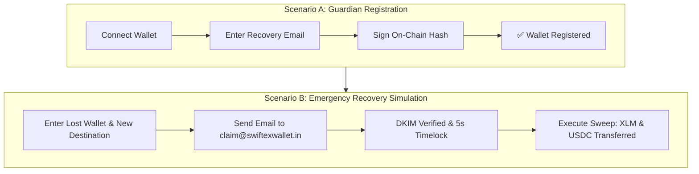
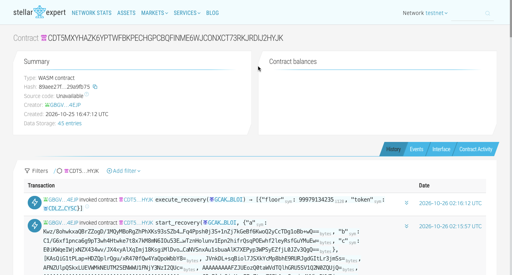

# 🚀 SpareKey End-to-End Walkthrough & Verification Guide

This guide provides comprehensive instructions for running, testing, and verifying the **SpareKey Zero-Knowledge Account Recovery** protocol on the Stellar Soroban Testnet.

---

## ⚡ Quick Start & Local Serving

To clone and run the application locally:

```bash
# 1. Clone the repository
git clone https://github.com/swiftexchange/swiftex-walletexchange.git
cd swiftex-walletexchange

# 2. Switch to the feature branch
git checkout feature/zk-email-recovery

# 3. Install dependencies
npm install

# 4. Copy the environment configuration
cp .env.example .env.development

# 5. Start the local server
npm run dev
```

Open your browser at:
👉 **[http://localhost:8081](http://localhost:8081)**



---

## 🛠️ Step 1: Wallet Setup & Testnet Funding

1. Connect your Stellar Testnet wallet (via WalletConnect or any Stellar-compatible browser wallet).
2. Fund your testnet wallet:
   - Click the **Fund Wallet** button inside the app header, OR
   - Use the [Stellar Laboratory Friendbot](https://laboratory.stellar.org/#account-creator?network=test) to fund your public address with testnet XLM.

---

## 🧪 Step 2: Protocol Verification Walkthrough

### Scenario A: Registering a Guardian (Protecting Your Wallet)

1. **Connect Wallet:** Click **Connect Wallet** in the top-right corner.
2. **Navigate to Recovery:** In the navigation menu, select **Recovery**.
3. **Register Guardian:**
   - Go to the **Register Guardian** tab.
   - Enter your personal recovery email address (e.g. `yourname@gmail.com`) and confirm it.
   - Choose the assets to protect (XLM is auto-protected with a 2 XLM reserve floor; USDC if trustline is active).
4. **Sign On-Chain:** Click **Continue** and approve the transaction in your connected wallet.
   - _Under the hood:_ The client computes `Poseidon(Email, Salt)` locally and submits the commitment hash to the **SpareKey Soroban contract** (`CDT5MXYHAZK6YPTWFBKPECHGPCBQFINME6WJCONXCT73RKJRDIJ2HYJK`). Your cleartext email is never submitted to the blockchain.
5. **Confirmation:** The interface transitions to **Wallet Registered** and displays the verified on-chain registration summary.

---

### Scenario B: Simulating Emergency Recovery (Lost Key Access)

Simulate losing access to the original wallet:

1. **Destination Wallet:**
   - Prepare a secondary Stellar wallet address (or connect a secondary wallet) to receive recovered funds.
2. **Go to Recover Funds:**
   - Click **Recovery** ➔ **Recover Funds** tab.
3. **Specify Addresses:**
   - **Original (Lost) Stellar Wallet:** Enter the public key of the wallet you protected in Scenario A (`G...`).
   - **New Destination Wallet:** Enter or paste your destination Stellar address.
4. **Trigger Emergency Recovery via Email:**
   - Open your email client (Gmail) logged into the email registered in Scenario A.
   - Send an email to: **`claim@swiftexwallet.in`**
   - In the **Subject line**, paste your **New Destination Wallet Address** (e.g. `GBBD47...`).
   - Leave the body blank or type any text, and click **Send**.
5. **Track Progress in UI:**
   - In the UI, click **I've Sent the Email — Track Status**.
   - The relayer ingests the email, parses the cryptographic DKIM header, generates a Groth16 ZK proof, and submits the recovery challenge to the Soroban contract.
6. **Timelock Countdown:**
   - For demonstration on Testnet, the contract enforces a **5-second safety timelock** (on Mainnet, this is 7 days).
   - The countdown bar will tick down from 5s to 0s.
7. **Autonomous Sweep Execution:**
   - Click **Execute Recovery**.
   - The Soroban smart contract sweeps the protected XLM and USDC balances to your new destination wallet!
   - A success confirmation displays the transaction hashes and updated destination balances.

---

## 🔍 On-Chain Verification

Every step can be independently audited on the Stellar Testnet block explorer:

[](https://stellar.expert/explorer/testnet/contract/CDT5MXYHAZK6YPTWFBKPECHGPCBQFINME6WJCONXCT73RKJRDIJ2HYJK)

- **SpareKey Smart Contract on Stellar.Expert:**  
  [https://stellar.expert/explorer/testnet/contract/CDT5MXYHAZK6YPTWFBKPECHGPCBQFINME6WJCONXCT73RKJRDIJ2HYJK](https://stellar.expert/explorer/testnet/contract/CDT5MXYHAZK6YPTWFBKPECHGPCBQFINME6WJCONXCT73RKJRDIJ2HYJK)

- **Native XLM SAC Address:**  
  `CDLZFC3SYJYDZT7K67VZ75HPJVIEUVNIXF47ZG2FB2RMQQVU2HHGCYSC`

- **Testnet USDC SAC Address:**  
  `CBIELTK6YBZJU5UP2WWQEUCYKLPU6AUNZ2BQ4WWFEIE3USCIHMXQDAMA`

---

## 🎯 Architecture Highlights

- **100% Self-Custodial:** No private keys or seed phrases leave the user's custody.
- **Zero On-Chain Email Leak:** Poseidon ZK hash commitment preserves privacy against public surveillance.
- **Reserve Protection:** Built-in 2 XLM floor prevents account un-funding.
- **Production-Ready Relayer:** Live DKIM verification via Google Gmail mail server signatures.
