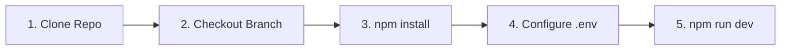

# ⚙️ Installation & Setup Guide: SpareKey Recovery

This guide walks you through setting up the **SpareKey Recovery Module** locally for development, testing, and evaluation.

---

## 📋 Prerequisites

Before you begin, ensure you have the following installed:

- **Node.js:** `v20.x` or later (Node 18+ is compatible, but Node 20+ matches `package.json` engine requirements).
- **npm:** `v10.x` or later.
- **Stellar Wallet:** Any Stellar Testnet compatible wallet (e.g., Freighter, Albedo, or any mobile wallet via WalletConnect).



---

## 🚀 Quick Setup Instructions

### 1. Clone the Repository

```bash
git clone https://github.com/swiftexchange/swiftex-walletexchange.git
cd swiftex-walletexchange
```

### 2. Check Out the Hackathon Feature Branch

```bash
git checkout feature/zk-email-recovery
```

### 3. Install Dependencies

```bash
npm install
```

---

## 🔑 Environment Variables Configuration

The project uses Vite environment files. Create a `.env.development` file in the root directory:

```bash
cp .env.example .env.development
```

Ensure the following variables are present:

```env
# Network Configuration
VITE_ENABLE_TESTNET=true

# SpareKey Relayer API
VITE_BASE_RECOVERY_URL=https://hackathon.swiftexchange.io/api/v1/recovery
VITE_RELAYER_EMAIL=claim@swiftexwallet.in

# Stellar Soroban Smart Contract IDs
VITE_SPAREKEY_CONTRACT_ID=CDT5MXYHAZK6YPTWFBKPECHGPCBQFINME6WJCONXCT73RKJRDIJ2HYJK

# Stellar Network RPC & Horizon
VITE_SOROBAN_RPC_URL=https://soroban-testnet.stellar.org
VITE_HORIZON_URL=https://horizon-testnet.stellar.org
VITE_STELLAR_NETWORK_PASSPHRASE="Test SDF Network ; September 2015"
```

---

## 🏃 Running the Application

### Development Server

Start the Vite development server:

```bash
npm run dev
```

The application will start on:
👉 **`http://localhost:8081`**

Open your browser and navigate to the **Recovery** link in the navigation menu or sidebar.

---

## 🔍 Validation & Health Checks

You can run these scripts to ensure the codebase is clean:

```bash
# Type check TypeScript code
npx tsc --noEmit

# Run ESLint linter
npm run lint

# Build production bundle
npm run build
```
